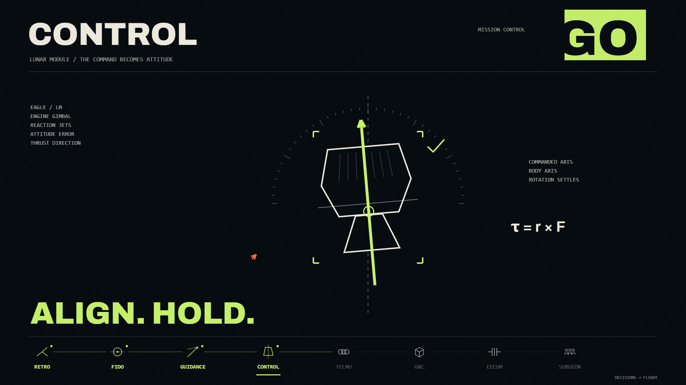

# 阿波罗：一次共同的抵达

**Apollo — A World Away** · 中文 | [English](README.en.md)

用网页代码绘制的阿波罗 11 号概念 MV。三维飞船、月面、工程关系图和文字跟随 Public Service Broadcasting《Go!》的节奏展开：一声声局部判断，最终汇成一次共同的行动。



这个仓库保存 **4 分 12.73 秒原版**的渲染源码，以及便于独立运行的新播放器和导出工具。它不包含后续修订镜头、商业歌曲文件或带歌曲的成片。

## 看见的不只是“登上月球”

故事从地面的工作与遥远的目标开始。控制员依次回答 Go，各自确认的条件逐步连成下降许可；飞船的运动又把新的证据带回地面。报警、地形、速度与燃料余量让判断接受现实检验。着陆之后，还有一次能否留下的检查。

最后，月面的 Eagle、轨道中的 Columbia 和地面的团队仍在共同工作。抵达是成果，也是仍然运转的协作。

创作时的核心约束是：**高密度意味着不断增加理解，不只是不断增加东西。** 小字、线条和模型尽量解释正在发生的变化；每声 Go 既是音乐上的击打，也让画面推进一步。历史依据与艺术处理范围见[来源说明](docs/SOURCES.md)。

## 本地预览

需要 **Node.js 20 或更新版本**，以及支持 WebGL2 的现代浏览器。

```bash
git clone https://github.com/Epsilonmeow/apollo-go-mv.git
cd apollo-go-mv
npm start
```

然后在浏览器打开 **http://127.0.0.1:5199/**。启动预览不需要先运行 `npm install`；页面使用仓库内的 Three.js 与字体资源。

- 可以直接无声预览完整画面，并拖动进度检查任意镜头。
- 在播放器中选择你本地可合法使用的音频，声音通过浏览器本地读取，**不会上传到服务器**。
- 为匹配既有节奏，使用从曲首开始、没有额外静音或剪接的《Go!》完整版本。原制作音轨长度为 **252.720544 秒**；其他版本可能需要自行调整时间节点。
- 请选择浏览器能够解码的普通音频文件。播放器不提供音乐下载，也不处理 NCM 等受保护的容器格式。

## 导出图片或视频

导出使用独立的无界面 Chromium 逐帧渲染，不操作你日常使用的浏览器。先安装开发依赖和浏览器：

```bash
npm install
npx playwright install chromium
```

导出视频还需要 FFmpeg 可执行程序。若它不在 `PATH`，设置环境变量 `FFMPEG_PATH` 为其完整路径。也可以通过 `CHROME_PATH` 指定已有的 Chromium/Chrome；使用外部 Playwright 安装时可设置 `PLAYWRIGHT_MODULE_PATH`。

导出一张图片：

```bash
npm run render -- --still --time 77.35 --output output/preview.png
```

先试一个两秒的无声片段：

```bash
npm run render -- --start 76 --duration 2 --fps 30 --width 1280 --height 720 --output output/sample.mp4
```

导出完整版，并使用你自己的音频文件：

```bash
npm run render -- --audio "/path/to/Go!.wav" --output output/apollo-go.mp4
```

完整版默认 **1920 × 1080、60 fps**，共 **15,164 帧**，视频时长约 252.733333 秒。原音轨比最后一帧结束早约 12.8 毫秒，这是帧数取整的结果。逐帧导出可能耗时较长，建议先完成短片测试。`output/` 中的本地产物不纳入 Git。

工具在产物旁写入 `.report.json` 记录进度和验证结果；默认拒绝覆盖同名产物，再次导出请换文件名，或明确加上 `--overwrite`。

## 工程结构与检查

| 位置 | 内容 |
| --- | --- |
| `film/` | 按原段落目录保留的 26 个原创渲染模块、2 个 Three.js 模块与字体资源 |
| `docs/ARCHITECTURE.md` | 渲染、时间轴、播放器与导出的关系 |
| `docs/SOURCES.md` | 历史资料、声音出处、图形表达范围 |
| `docs/assets/preview.jpg` | 无音频的原版画面截图 |
| `output/` | 本地导出目录，已忽略 |

```bash
npm test
npm run check
```

`npm test` 检查静态文件与本地服务；`npm run check` 使用浏览器检查公开播放器和渲染入口，需先安装上述开发依赖与 Chromium。检查通过不等于在所有 GPU、浏览器或字体环境中逐像素一致，也不代替观看最终导出文件。

## 创作与许可

本次已完成的验证与尚未覆盖的范围见[公开工程检查](docs/VERIFICATION.md)。

本片由 **Epsilonmeow** 主导创作方向、参考分析、反馈与验收，借助 **Codex / GPT6-Astra** 迭代设计、编程实现和工程整理。模型由程序生成；图形使用 Three.js、Canvas 2D 与着色器组合完成。

- 原创源码和文档采用 [MIT License](LICENSE)。
- Three.js 使用 MIT License；Archivo 字体使用 SIL Open Font License。对应许可随依赖保留。Consolas 是系统字体名称，不在仓库中分发。
- 配乐：**Public Service Broadcasting — Go!**。歌曲及其中的录音不属于本仓库的 MIT 授权范围；仓库不分发歌曲或带歌曲的 MP4。
- NASA 档案、Apollo Journals 编注和其他资料各有来源。这里提供引用与创作说明，不将外部资料统一改为 MIT。

可以从源码学习、修改或制作自己的画面。若要发布包含音乐或第三方素材的新成片，需要自行确认这些材料的使用权限。
